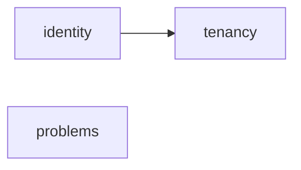

# API modules

Generated from the Spring Modulith modules by `ModularityTests.moduleDiagramMatchesTheCode`. When it fails, it writes the new diagram to `target/modules.md` and prints the command that copies it here.

