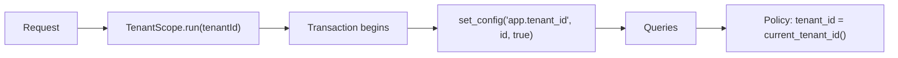

# 0001. Tenant isolation with row-level security

Status: Proposed

## Context

Every tenant's data lives in one PostgreSQL database and one schema. A query that forgets its tenant filter must fail,
not read or write another tenant's rows. The application scopes its own queries, but one missed filter would leak, and
nothing in the application layer alone would catch it.

## Decision

PostgreSQL row-level security is the safety net under the application's scoping, and it fails closed.

- **Two roles.** Flyway connects as `counthouse_migrator`, which owns the database and every table but is not a
  superuser. The API connects as `counthouse_app`, which owns nothing, cannot bypass row-level security and receives
  explicit grants per table.
- **Policies fail closed.** Every table forces row-level security, except `tenants` (enabled, not forced: the migrator
  creates tenants) and Flyway's history. Every policy compares `tenant_id` with `current_tenant_id()`, which raises
  when no tenant is set.
- **The tenant is set per transaction.** `TenantScope` binds the tenant in a `ScopedValue`. The transaction manager
  refuses a transaction outside a scope and starts each one with `set_config('app.tenant_id', ?, true)`, which ends
  with the transaction. A scope cannot switch to another tenant.
- **Clean connections.** The setting is reset each time a connection is taken from the pool, so a value left on a
  connection by a mistake never reaches a query outside a transaction.
- **Rules on the catalog.** PostgreSQL does not apply row-level security to `TRUNCATE`, and foreign key and unique
  checks bypass it. So foreign keys, unique keys and exclusion constraints on tenant tables include `tenant_id`,
  primary keys are single random UUIDs, the API role has no
  `TRUNCATE`, `REFERENCES` or `TRIGGER`, and `PUBLIC` loses `TEMPORARY` on the database, since a temporary table would
  shadow a real one without its policies. Tests over the catalog enforce each rule for every table, and each rule is
  shown failing on a test-only schema of tables that break it.
- **Migrations outside the API.** Deployed environments run Flyway as a separate step with the migrator's
  credentials; the API's environment holds only `counthouse_app`'s. The API runs Flyway itself only in local
  development and tests.

## Alternatives

- **A database or a schema per tenant.** Strong isolation, but migrations, backups and connections multiply per tenant
  on a single server.
- **Filtering in the application only.** Simple, but one forgotten filter leaks, silently.
- **Hibernate filters or `@TenantId` alone.** They cover entity queries, not native SQL or `JdbcClient`. `@TenantId`
  is still planned above row-level security, with the first tenant-owned entity.

## What this does not protect against

- A process that holds the migrator's credentials. The owner can drop `FORCE` or a policy, which is why deployed APIs
  do not hold them.
- SQL injection inside a transaction: the injected SQL can set any tenant. Bound parameters are that defence.
- Data the policies do not cover: large objects, which the API does not use.
- A wrong tenant chosen by the application. Row-level security enforces the tenant it is given; choosing it from the
  signed-in user is the authentication layer's job.

## Consequences

- One extra statement per transaction and one per connection checkout.
- Role names are fixed in the migrations. Each environment creates both roles before Flyway runs and sets no default
  for `app.tenant_id`, since a reset returns to that default.
- There is no path for work without a tenant yet. One is designed with its first caller, such as finding the tenant
  from a hostname.
- Executor and `@Async` threads do not inherit the scope, so asynchronous work fails closed until it enters the scope
  again. Event listeners that start their own transaction need a task decorator that carries the tenant.
- The API stores no large objects, which row-level security does not cover.
